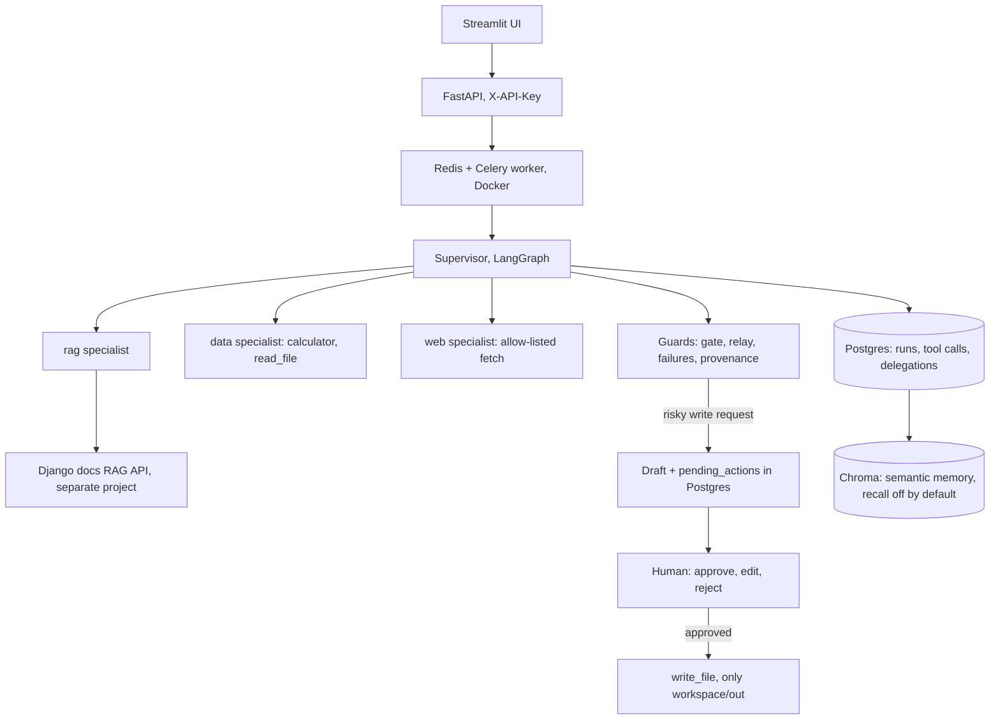

# Agent orchestrator: a measured multi-agent system on a local 4B model

Supervisor and specialist agents (LangGraph) with tool use, Postgres and Chroma memory, human approval before any file write, a Celery/Redis queue, a FastAPI API and a Streamlit UI. Everything runs free and locally (Ollama, qwen3.5:4b on an 8 GB GPU). No paid API is needed to run or test anything.

The main result is negative and honest: on this model and task set, the supervisor architecture showed **no measurable accuracy gain** over a single agent and cost about 1.7x the latency. Deterministic guardrails mattered more than architecture.

## Architecture



- The LLM layer is one provider interface; Ollama is the default and the only adapter built.
- `write_file` is not an agent tool. Only the human-approval path can call it, confined to `workspace/out/`.
- `eval/run_eval.py` never imports the memory or review code (a test enforces it).

## Results

Scoring is deterministic: exact refusal string, numeric tolerance, keyword and tool checks, and an escalation flag. There is no LLM judge. Intervals are 95% Wilson. Temperature 0, seed 42, one run per configuration (two identical runs were seen at dev for single v1 and v2).

### Frozen test split (12 tasks, run once after tag `freeze-before-test`)

| Config | Success | 95% CI | Esc. precision / recall | Steps | Latency |
|---|---|---|---|---|---|
| single v2 | 10/12 | 55-95% | 2/2, 2/3 | 2.1 | 6.6 s |
| single v2 + guards | 10/12 | 55-95% | 2/2, 2/3 | 2.0 | 6.2 s |
| supervisor | 9/12 | 47-91% | 2/2, 2/3 | 3.8 | 11.1 s |
| supervisor + guards | 10/12 | 55-95% | 3/3, 3/3 | 3.8 | 10.4 s |

Invalid tool calls: 0/16, 0/16, 0/14, 0/15. Invalid supervisor plans: 0/12 in both supervisor runs. Expected tools used: single 7/7, supervisor 6/7. One task is 8.3 points, so these four rows are not distinguishable.

### Dev split (24 tasks, tuned on, optimistic)

| Config | Success | Steps | Latency |
|---|---|---|---|
| single v1 | 18/24 | 2.0 | 6.2 s |
| single v2 | 20/24 | 2.0 | 5.6 s |
| single v2 + guards | 24/24 | 1.8 | 5.2 s |
| supervisor v1 | 21/24 | 3.8 | 10.3 s |
| supervisor v2 | 22/24 | 3.8 | 10.2 s |
| supervisor v2 + all guards | 23/24 | 3.5 | 9.5 s |

A first single-agent run at default sampling scored 17/24 before the temperature was fixed and a tool bug (empty redirects counted as success) was repaired.

### What the numbers say

1. Single and supervisor are statistically indistinguishable on test (at most one task of 12, overlapping intervals). The supervisor costs about 1.7x latency and 1.8x steps.
2. The guarded single agent scored 24/24 on dev and 10/12 on test. That drop is the overfitting signal: the guards were written against dev failures.
3. The 4B model's main failure is answering from memory instead of calling a tool, in both architectures.
4. Structured supervisor output worked: 0 invalid plans on 36 tasks. Reason-type labels were correct on the few model-assigned escalations (n too small for a rate).
5. Memory recall (similarity threshold 0.8, constructed scenario with paraphrased seeds): 0 of 24 dev tasks changed, and 0 of 2 deliberately wrong remembered answers leaked. Recall stays off by default and is not shown to help.

## Failure analysis

- **Specialist answers from memory** (`multi-05`, `ref-03`): the data specialist skipped the calculator and used a wrong formula that happened to yield the right number.
- **Fallback refusal sentence** (`esc-tool-02`, `esc-tool-03`, `esc-risk-02`): the supervisor used the refusal text as a generic "cannot help". The `provenance` guard catches it.
- **Refusal not relayed** (single agent): the model ignored the instruction to return the exact sentence. A deterministic `relay` guard fixes it.
- **Prose instead of escalation** (`esc-amb-03`, single agent): a clarifying question is not an `ask_human` call.
- **Retrieval mismatch** (`rag-08`, all four configs): the RAG API answered about Django's contributor `runtests.py`, not `manage.py test`. This is a limit of the RAG project, not the agents.
- **Invented flag in an approved draft:** two drafts contained `--skip-initial-run`, which is not in the docs (only `--fake-initial` is). A human approved both because the first review view showed only 200 characters. The UI now shows the full draft, but review is only as good as the reviewer.

## Human-in-the-loop

Write requests are gated by rule, not by the model. The supervisor wrapper extracts the topic and target path deterministically, fetches source text through the RAG tool, drafts content with one JSON-constrained model call and queues a proposal in Postgres. A human approves, edits or rejects, in the UI, the API or `scripts/hitl.py`. State survives a Postgres restart (verified). Draft quality is not scored. Only 4 write prompts were tried, all my own.

## Queue behavior (measured on single tasks)

- Default Celery settings: a task running during a worker restart was lost (state stays STARTED forever).
- Late acks with the default 1 h Redis visibility timeout: the message stayed parked in Redis.
- Late acks with a 300 s timeout: the interrupted task was redelivered and finished. Delivery is at least once: each interruption leaves an orphan `escalate` run next to the redelivered one (runs 17, 18, 20 in my database). The timeout must stay above the longest task.

## Privacy and retention

- Everything is processed locally. Embeddings are computed locally; no prompt or answer leaves the machine except calls to the local Ollama and the separate local RAG API.
- Prompts, answers, tool outputs and drafts are stored in plain text in two Docker volumes (`pgdata`, `chroma_data`). Nothing is encrypted at rest.
- The API requires `X-API-Key` on everything except `/health`, and refuses all requests if the key is unset. Secrets live in a gitignored `.env`.
- Delete one run from both stores: `python scripts\run_task.py --forget 12`.
- Delete all runs: `docker compose exec postgres psql -U agent -d agentlab -c "DELETE FROM runs;"` (child rows cascade; delete `pending_actions` separately, and the Chroma collection `run_memory` via the client).
- Never use `docker compose down -v` unless you mean to erase all data.

## Reproduce

Requirements: Windows 11 with PowerShell, Python 3.12, Docker Desktop, Ollama with `qwen3.5:4b`, and the separate Django-docs RAG API running on port 8000 with its key.

```powershell
py -3.12 -m venv .venv
.\.venv\Scripts\Activate.ps1
pip install -r requirements.txt
Copy-Item .env.example .env        # then set RAG_API_KEY and ORCH_API_KEY
docker compose up -d
python scripts\check_env.py
python -m pytest -q                # 233 passed on the author's machine
python eval\run_eval.py --split dev --prompt v2 --guards gate relay failures
python eval\run_eval.py --split dev --agent supervisor --guards gate relay failures provenance
```

The test split needs `--final` and should be run once. Exact working versions are in `requirements-lock.txt` (host) and `requirements-app-lock.txt` (containers). They differ on langgraph (1.2.17 vs 1.2.18) because dependencies were not pinned during development.

## Limitations

- Test set of 12 and dev set of 24, both written by one person, in similar style. One task moves a score by 4 to 8 points.
- Guards and prompts were written after reading dev failures. Dev numbers are optimistic; the test numbers are the honest ones.
- One run per configuration at temperature 0. Reproducible on this machine, not shown elsewhere.
- The write gate keys on verb plus path vocabulary and has a known false positive (for example removing a field in `models.py`).
- Draft quality, UI behavior and the queue-recovery behavior are not covered by automated or repeated measurement; the UI is untested beyond its API client.
- The Streamlit page's behavior while the API is stopped was not verified.
- `supervisor.py` gained an optional `note` argument after the freeze. A dev rerun reproduced the earlier run exactly (0 of 24differ); it was not re-run on test.
- Dependencies were unpinned during development.

## Declared edits after seeing dev failures

Prompt v2; the three single-agent guards; the supervisor `reason_type` mapping; two supervisor prompt rules; the `provenance` guard; the deterministic topic step for write sourcing. The test split was run once, after the freeze tag, for four configurations, and nothing was changed afterwards on the agent or eval path.
